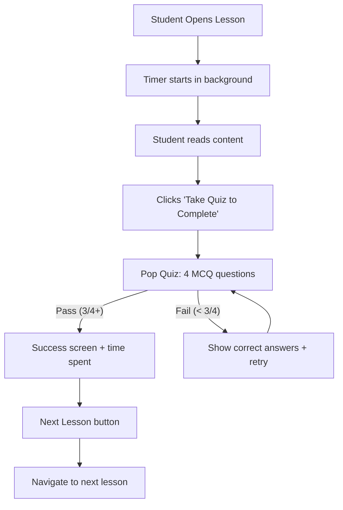

# Enhanced Student Lesson Experience

## Current State
- Student sees lesson HTML content with a "Mark as Complete" button
- No time tracking, no quiz gate, no next lesson, no revisit tracking
- `training_progress` table only stores `student_id, lesson_id, module_id, completed_at`

## New Behavior



---

## 1. Database: Add time tracking and revisits

**New migration** `084_lesson_time_tracking.sql`:

```sql
CREATE TABLE IF NOT EXISTS training_lesson_visits (
  id UUID PRIMARY KEY DEFAULT gen_random_uuid(),
  student_id UUID NOT NULL REFERENCES users(id),
  lesson_id UUID NOT NULL REFERENCES training_lessons(id) ON DELETE CASCADE,
  started_at TIMESTAMPTZ NOT NULL DEFAULT NOW(),
  ended_at TIMESTAMPTZ,
  duration_seconds INT
);
CREATE INDEX idx_lesson_visits_student ON training_lesson_visits(student_id);
CREATE INDEX idx_lesson_visits_lesson ON training_lesson_visits(lesson_id);

-- Add time_spent_seconds to progress for total aggregation
ALTER TABLE training_progress ADD COLUMN IF NOT EXISTS total_time_seconds INT DEFAULT 0;
ALTER TABLE training_progress ADD COLUMN IF NOT EXISTS visit_count INT DEFAULT 1;
```

This tracks:
- Every visit (start + end time + duration)
- Total accumulated time on `training_progress` for quick queries
- Visit count for revisit analytics

---

## 2. Backend: New endpoints

In [backend/src/services/training.service.ts](backend/src/services/training.service.ts):
- `startLessonVisit(studentId, lessonId)` -- creates a visit row, returns visit ID
- `endLessonVisit(visitId, durationSeconds)` -- updates ended_at and duration
- Update `markLessonComplete` to also record total_time_seconds and increment visit_count

In [backend/src/api/v1/training.routes.ts](backend/src/api/v1/training.routes.ts):
- `POST /training/lessons/:id/visit` -- starts a visit, returns `{ visitId }`
- `PUT /training/lessons/visit/:visitId/end` -- ends a visit with duration
- `POST /training/lessons/:id/quiz` -- generates a 4-question MCQ pop quiz from the lesson content (uses existing `generateQuestions` with count=4 and topic=lesson title)
- Modify `POST /training/lessons/:id/complete` to require a `quizScore` in the body (must be >= 75% to allow completion)

---

## 3. Frontend: Redesign InternshipLesson.js

In [src/pages/internship/InternshipLesson.js](src/pages/internship/InternshipLesson.js):

**States:**
- `reading` -- student is reading the lesson (timer running)
- `quiz` -- student is taking the pop quiz
- `passed` -- student passed, showing success + next lesson
- `failed` -- student failed, showing answers + retry

**Timer:**
- Start a visit on component mount (`POST /lessons/:id/visit`)
- Track seconds with `useRef` + `setInterval`
- Display elapsed time as a small chip in the header (e.g., "5:32")
- On unmount or navigate away, call `PUT /lessons/visit/:id/end`

**Pop Quiz Flow:**
- Replace "Mark as Complete" button with "Take Quiz to Complete"
- On click: call `POST /training/lessons/:id/quiz` to get 4 MCQ questions
- Show each question with 4 radio buttons (one page, scroll through)
- On submit: if 3/4+ correct, call `POST /lessons/:id/complete` with quizScore
- If failed: show which answers were wrong with explanations, offer "Try Again" (generates new questions)

**After Completion:**
- Show success card with: checkmark, time spent, score
- "Next Lesson" button (navigates to next lesson by sort_order in the module)
- If it was the last lesson: "Back to Module" button + congratulations

**Completed/Incomplete distinction:**
- If lesson is already completed (from `completedLessonIds`), show a "Completed" banner at the top
- Still allow re-reading but hide the quiz button
- Show "Revisiting" chip with accumulated time

---

## 4. Frontend: Update InternshipModule.js lesson list

In [src/pages/internship/InternshipModule.js](src/pages/internship/InternshipModule.js):
- Completed lessons show a green checkmark icon + "Completed" chip
- Incomplete lessons show a play icon
- Currently active (next uncompleted) lesson gets a subtle highlight

---

## 5. Teacher/Admin Analytics

The `training_lesson_visits` table provides:
- Time spent per student per lesson (for admin/teacher dashboard)
- Visit count (revisits)
- These can be exposed on the existing grades/progress views later

---

## Key Files to Modify
- `backend/src/db/migrations/084_lesson_time_tracking.sql` -- new table + columns
- `backend/src/services/training.service.ts` -- visit tracking functions
- `backend/src/api/v1/training.routes.ts` -- new endpoints (visit, quiz, modified complete)
- `src/pages/internship/InternshipLesson.js` -- full redesign with timer, quiz, next lesson
- `src/pages/internship/InternshipModule.js` -- completed/incomplete visual distinction
